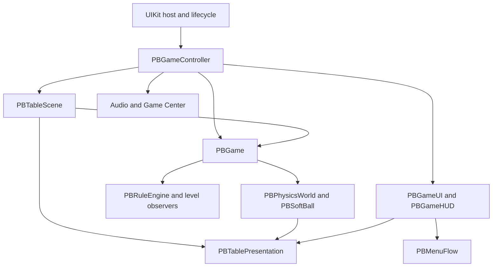

# Architecture

Pinball is a portrait iPhone application in Objective-C with ARC. It combines a custom simulation,
SceneKit world, transparent SpriteKit interface, and synthesized audio. The app and standalone
macOS verification tools share production modules; there is no Mac gameplay app target.

See [AGENTS.md](AGENTS.md) for constraints, [CONTRIBUTING.md](CONTRIBUTING.md) for commands,
and [docs/README.md](docs/README.md) for specialist guides. This describes the current code.

## Ownership

| Location | Responsibility | Main types |
| --- | --- | --- |
| `App/` | UIKit host, lifecycle, composition, frame loop | `PBAppDelegate`, `PBGameViewController`, `PBGameController` |
| `App/Core/` | Table model, simulation, rules, input, levels, projection, validation | `PBTableDefinition`, `PBPhysicsWorld`, `PBRuleEngine`, `PBGame`, `PBLevels`, `PBTablePresentation`, `PBLayoutValidator` |
| `App/Scene/` | Scene graph, materials, geometry, skins, backdrop blur | `PBTableScene`, `PBGeometry`, `PBSkin`, `PBModelLibrary`, `PBPlayfieldPainter`, `PBBackdropBlur` |
| `App/UI/` | Overlay, HUD, menus, effects, pointers | `PBGameUI`, `PBGameHUD` |
| `App/UI/Model/` | Graphics-free navigation policy | `PBMenuFlow` |
| `App/Audio/` | Synthesized sound | `PBSoundEngine` |
| `App/GameCenter/` | GameKit authentication, dashboard, submissions | `PBGameCenter` |
| `App/GameCenter/Scoring/` | Graphics-free eligibility/pending-score persistence | `PBGameCenterScores` |

`App/Core` uses Foundation, Core Graphics, and SIMD, with no UIKit, AppKit, SceneKit, or SpriteKit.
Rendering consumes simulation state; SceneKit physics is deliberately unused. Menu policy and score
persistence are also compiled into the headless XCTest target.

## Frame loop and threading

`PBGameController` is the SceneKit renderer delegate; the view requests 60 frames per second.
Each active `renderer:updateAtTime:` locks the SceneKit transaction, advances the game, synchronizes
scene nodes, and emits interface effects. Periodic score/level snapshots dispatch to main for UI
coordination. Pause resets the frame clock so returning does not simulate time spent away.

`PBGame update:` runs in this order:

1. Consume atomic input, cancellation, and new-game requests.
2. Advance `PBPhysicsWorld` with an accumulator at **960 Hz**, with bounded catch-up.
3. Drain physics events into rules, then notify game observers.
4. Advance rule timers.

The world owns ball arrays, colliders, a spatial grid, flippers, gates, ramps, and actuators.
Events carry type, element/ball index, position, magnitude, and physics tick. Magnitude is event-specific:
wall impact speed differs from normalized plunger pull. Copy event values before deferring work;
physics owns the backing event storage. Rules own score/progression and command world actuators.

UIKit input/lifecycle work runs on main and sends atomic commands rather than touching live balls.
Scene swaps and resize operations use the transaction lock. SpriteKit additionally requires
`PBGameUI.applyChange:`: mutations queue under its own lock and execute in overlay `update:`.
A SceneKit lock alone does not protect SpriteKit rendering.

## Input and lifecycle

The view controller offers pointers to the interface first. Menus/buttons consume their pointers;
decorative HUD content passes gameplay touches through. Remaining fingers form one held primary
input, independent of touch location. `PBGame` resolves a fresh press on the simulation thread:

| State | Action until release |
| --- | --- |
| A free, non-captive ball waits at the plunger | Charge the spring; release launches |
| Otherwise, a free ball is left of screen centre | Raise the left flipper |
| Otherwise, a free ball is at/right of centre | Raise the right flipper |
| No eligible free ball | No action |

Multiball chooses the lowest free, non-captive ball; a waiting launch ball takes priority. The action
is latched, so crossing centre while held does not change flippers. Extra fingers maintain the press
until the last gameplay finger lifts. Direct left/right/plunger setters remain for autopilot/tools.
Cancellation, interruption, and pause discard charge without firing. Restart clears the held action.

`PBMenuFlow` decides navigation; the controller executes start/abandon commands and coordinates
pause, results, and levels. Starting/resuming requires explicit UI actions. Core Motion supplies
shove nudges, never lighting changes. Haptics consume game events with thresholds/rate limiting;
a real phone is required to evaluate motion, haptics, and performance.

## Coordinates and framing

Table `x` runs across the board, `y` up-table, and ball `z` records height. The nominal table is
1.0 × 1.9. Mesh authoring is Z-up; export converts to SceneKit Y-up, mapping table up to negative
scene Z. Rolling and elastic strain use the same basis conversion.

`PBTablePresentation` defines the close orthographic camera, 20 degrees from overhead, and
converts table positions to/from top-left view points. SpriteKit needs the corresponding vertical
conversion. Elevation shifts projected position without perspective scaling.

Camera, HUD, physics display bounds, and headless checks share this projection. On resize, the
controller refits camera/bounds and relays safe-area layout. `PBTableDisplayBoundary` creates an
invisible contour around sides and rounded top corners, open at the drain. Collider thickness is
compensated so contact reaches the display edge. Radius is estimated from safe areas, with no
Dynamic Island obstacle. XML's outer contour is a reference; runtime fits the viewport.

The approved lower-kit axis is x = 0.457; the phone centre for the shared board is x = 0.5.
Use the former for hardware symmetry and the latter for casual input, without moving one to match
another. Projection changes must also update authoring checks and preview framing.
The four straight lower lane sections clear 0.08125 between physical faces, with centred lamps
and rollover bars. The XML reference contour matches the runtime reference viewport, so authoring
checks measure the same left outlane boundary used in play. Tooling derives the lower axis from
the flipper pair rather than freezing an older centre value.

## Ball and moving hardware

Table data supplies one ball radius, currently **0.03417**: 15% below the former visible
0.03 × 1.34 radius. Mesh and spherical collider use it directly, with coincident undeformed centres.
No mesh-only enlargement is allowed. Tests cover lane clearance, serving, full launches, rollback,
gate passage, flippers, and display corners.

`PBSoftBall` attaches passive elastic state to each physical ball. Real contacts excite a bounded
matrix spring: compression along the normal, transverse bulging, preserved volume, and a small
rebound. The solver advances strain, but collision geometry remains spherical. The renderer applies
strain before rolling and corrects floor/contact support. Serving/repositioning resets it. The
response must read at normal speed, not just in an enlarged slow-motion capture.

The coral ball uses nonmetallic uncoated rubber, roughness 0.68, clear coat 0, and subtle procedural
grain. [Art/MODEL_GUIDE.md](Art/MODEL_GUIDE.md) describes materials and deformation details.

`PBGateGeometry` shares hinge, bar height, wire radius, swing, and free endpoint between physics
and renderer. Admission is latched per ball; the moving collider/grid envelope follow the swing.
It rotates about fixed endpoint `a` in the table plane. Triangle tops are level, with concentric
rounded trim and bolts at corner arc centres; scene tests and real isometry verify this geometry.
Return guides keep their collision outline but render as plates at half/full height on three hollow
tubes, leaving a real shadowed gap. Flippers use a small flat, unslotted hinge detail with a dark washer;
the old domed hub and tip bolt are absent. These presentation meshes do not change flipper physics.

## World and interface rendering

`PBTableScene` builds the world and mirrors game state. `PBSkin` loads palettes, atlas regions,
and authored states. `PBModelLibrary` loads compiled kits and clones geometry for independently
animated material selection. Procedural fallback hardware supports skins without a model kit.

The background is full bleed. `PBGameUI` is transparent; `PBGameHUD` draws one score/target row,
pause, shooter-channel progress, and the dark drain well. Luckiest Guy registers at runtime;
licence/notice files stay in `GameData/Fonts/`. No Ball/Save/event rows or bright drain/channel
outlines are drawn. The controller centralizes popup blur through `PBBackdropBlur`.

Lighting is fixed. One directional key uses a manually fitted **4096 × 2048** shadow map with
32 samples; resize refits visible receiver/caster bounds. This resolution is a hard cap. Playfield
reflection is disabled in the renderer, with the former implementation/settings retained.

## Assets and generation

| Authored source | Output/consumer |
| --- | --- |
| `Scenes/base.xml`, `Scenes/tables/*.xml`, `Scenes/ramps.xml` | `GameData/Tables/*.json`, shared/table geometry |
| `Scenes/kit.xml` and table geometry | `Art/Models/premium/*.dae`, `Art/Models/manifest.json` |
| Generated `.dae` | `GameData/Models/premium/*.scn`, through Xcode `scntool` |
| `GameData/Levels.json` | `PBLevelCatalog` |
| Skin JSON/images, atlas layout, `GameData/UI/controls.json` | `PBSkin` and `PBGameUI` |
| `tools/make_xcodeproj.py` | Xcode project/target configuration |

`make scenes` invokes `tools/scene/compile_scenes.py`, then `tools/compile_models.sh`. iPhone uses
compiled `.scn`; COLLADA is an intermediate, not a runtime substitute. Scene checks verify generated
JSON against XML, base inheritance, resources, geometry/normals, and projected layout.

The campaign currently has one level, First Light (`aurora`): an upper-right
three-bumper nest, three top bonus lanes, a right spinner and two stand-ups. The layout has no ramp; the lower kit remains
shared. Its route contracts live in `GameData/Analysis/aurora.json`; see [the shot plan](docs/aurora.md).
Advanced mechanics remain exercised by `Tests/Fixtures/features.json`.

## Progress and platform services

`PBLevelCatalog` loads table/skin/goal pairs. `PBLevelSession` observes progress on the render thread.
`PBLevelProgress` saves improving stars/best scores by stable level ID, preserving progress across
reordering. Local high scores and sound/haptics/skin preferences use defaults in their owning modules.

`PBGameCenter` bridges GameKit. Only eligible manual games completed under the same authenticated
player submit scores. `PBGameCenterScores` retains the best pending score per player/table for retries;
an account switch must not submit another player's score. IDs live in `GameData/GameCenter.json`,
capabilities in `Config/Pinball.entitlements` and the project generator. A signed build does not prove
live authentication/upload behavior. `PBSoundEngine` synthesizes sound; the host implements haptics.

## Verification boundaries

`make test` combines Python scene checks, native shot probes using production physics, headless
XCTest, and real UI-node/input/projection checks. The UI checker can run without Metal, but that
mode does not render pixels. Native preview tools reuse working assets and production rendering
without requiring an app install.

Analysis also compiles production Core and exports reports, trajectories, heatmaps, and replay
inputs. It is not an alternate physics model. Autopilot statistics and exploratory probes do not
prove that a level is enjoyable or every proposed shot works well. Read
[CONTRIBUTING.md](CONTRIBUTING.md) for checks and [docs/README.md](docs/README.md) for deeper guides.
