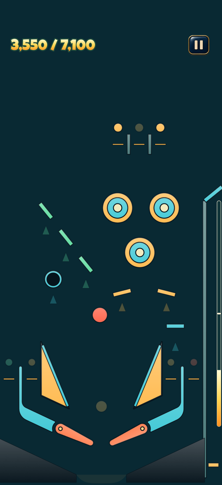

# Pinball

Mini-pinball in Objective-C and SpriteKit for iPhone. A compact, flat playfield uses readable
textured sprites, with a ball about 1/15 of the screen width and large targets inspired by match-3 sizing.



For contributors and agents, start with [AGENTS.md](AGENTS.md), [ARCHITECTURE.md](ARCHITECTURE.md),
and [CONTRIBUTING.md](CONTRIBUTING.md). The [documentation map](docs/README.md) links specialist guides.

Author tables in `Scenes/` XML, then run `make scenes` to compile runtime JSON. The shipping game
uses custom physics and SpriteKit for both board and HUD. First Light has three bumpers, three bonus
lanes, three drop targets, two stand-ups, a spinner and a timed scoop above the shared lower kit.
Ramps, locks and multiball are absent. Sound is synthesized.

```bash
open Pinball.xcodeproj
```

Schemes: `Pinball` (iPhone app) and `PinballCoreTests` (headless tests on Mac).

Or from the command line, where `make help` lists everything:

```bash
make iphone-deploy
```

That builds a signed Release app, installs it on the only connected iPhone, and launches it. Set
`DEVICE=<name or identifier>` when several are connected (`make list-devices`), `TEAM=<id>` to override the
team taken from your Apple Development certificate, and `CONFIG=Debug` for a debug build.
`make simulator-run` does the same in the Simulator, and `make test` runs the headless tests.

`App/` contains all application source and the asset catalog, with modules for simulation,
rendering, audio, interface, and Game Center. Tests and standalone preview tools compile the
modules they need directly from `App/`. `GameData/` holds runtime resources. There is no Mac app target.
`Art/` holds source artwork and models; `Tests/` and `tools/` hold verification and asset tooling.
Use the iPhone Simulator for gameplay checks and a real iPhone for motion, haptics, and performance.

## Controls

| Action | iPhone |
|---|---|
| Flippers | Press anywhere; the ball's half of the screen chooses the flipper. Release to lower it |
| Start / replay | PLAY / PLAY AGAIN |
| Pause / resume | Enamel pause button / RESUME |
| Plunger | With a ball waiting in the launch lane, hold anywhere to charge; release to launch |
| Nudge | Shove the phone |
| Next skin | Settings → CHANGE, or three-finger tap |
| Game Center | SCORES on the main menu or results screen |

Launch arguments: `-PBAutopilot 1` plays itself, `-PBSkin classic`, `-PBTable aurora`, `-PBStats 1`.
Use `-PBSkin orbital` or `-PBSkin abyss` to preview either new set directly.

The coral sprite ball deforms from actual physics contacts and recovers with a short rubber recoil.
Rendering uses texture shading without runtime 3D lights, shadow maps or reflections. The ball's
physical radius and visible silhouette share the authored size. Phone motion supplies nudges only.

## Game interface

The app uses one SpriteKit scene containing the textured playfield and transparent interface. **Peggle Blast is the
primary presentation reference**: a continuous illustrated background, clean unframed board edges,
and a compact gradient HUD, with no 3D cabinet or decorative side columns.
`PBGameHUD` draws this gameplay layer; `PBGameUI` owns the scene, menus, effects and touch routing.
A single Luckiest Guy row shows score / target below the device's safe area, with a cream-to-amber gradient and sage outline. A vertical progress gauge fills along the shooter channel. Ball/Save/event captions are omitted; there is no panel or reserved top strip.
The background reaches every edge; the display's own rounded corners replace the inset Roman arch.
The ball sprite silhouette and collider share radius 0.03417, about 1/15 of screen width in diameter.
The pause button has a finger-sized hit area and stays clear of the Dynamic Island or notch.
Existing menus include home, levels, pause, settings, help, results and restart/end confirmations.

The flat overhead projection and HUD share `PBTablePresentation` for safe-area framing and
projection. The compact 1.0 × 1.6 board fills the display width on small and large portrait phones.
The approved lower collision kit remains shared. See [agent instructions](AGENTS.md) for art direction
and [UI guide](Art/UI_GUIDE.md) for interface ownership.

Settings persist between launches. App inactivity pauses a live run and returns to the pause screen;
the player explicitly resumes. Results remain visible until choosing replay or the main menu. Autopilot
previews bypass the interface. See [Art/UI_GUIDE.md](Art/UI_GUIDE.md) for artwork, layout, and verification.

Haptics follow ball bounces, with stronger pulses for active elements and launch feedback scaled to
the plunger pull. Drawing the plunger ticks like a spring winding, tightening up to a firm stop at full pull. Tiny resting contacts stay quiet. Haptics can be disabled in Settings.

## Game Center

The app initializes GameKit once its window appears. The custom SCORES button opens
the Game Center dashboard, including leaderboards. The floating native access point is hidden.
Play pauses during sign-in, the dashboard, and app inactivity, without advancing the ball through
the time spent away. A live run stays at the pause menu until the player resumes.
Autopilot previews skip Game Center entirely.

At game over, the final score (including bonus) is submitted to the table's classic leaderboard.
Only games started and finished with the same authenticated Game Center player qualify. Signed-out
games still work and retain the existing local high score. Failed submissions persist as the best
pending score per player/table and retry on authentication, foregrounding, connectivity restoration,
the next completed game, and every 60 seconds while the app is active. A connectivity signal does not
guarantee that Apple is reachable; failed uploads remain queued.
Signing out or switching players invalidates the live run, even when the original player returns.
An account switch never uploads another player's pending scores.

Before testing live services:

1. Select your development team for the app target and enable Game Center for its App ID. The
   checked-in entitlements and generated Xcode target capabilities already request Game Center.
2. In App Store Connect, enable Game Center for the app and create a **classic leaderboard** with ID
   `com.igorchernakov.pinball.aurora.highscore`, named **Aurora High Scores**. Set score format to
   integer, sorting to **High to Low**, and submission policy to **Best Score**; add a localization
   and associate the leaderboard with the app version. Set it as the default leaderboard.
3. IDs are configured in `GameData/GameCenter.json`, keyed by table identifier.
   Use matching IDs in App Store Connect, or update this
   mapping to your existing IDs. A new table needs its own mapping.
4. Run a signed build with a Game Center test account, finish a manual game, then choose SCORES.
   Test cancellation, offline upload/retry, and changing accounts as well.

Unsigned builds verify compilation but cannot validate Game Center authentication or live uploads.
`python3 tools/make_xcodeproj.py` preserves the capability, entitlement path, and GameKit link settings.
Apple's [Game Center setup guide](https://developer.apple.com/documentation/gamekit/initializing-and-configuring-game-center)
and [leaderboard configuration guide](https://developer.apple.com/help/app-store-connect/configure-game-center/manage-leaderboards/)
cover the account-side configuration.

Run `make game-center-check` for portable configuration checks, and on the signing Mac:

```bash
make test
make iphone TEAM=<team-id>
python3 tools/check_game_center.py --app Build/Device/Build/Products/Release-iphoneos/Pinball.app
make iphone-deploy TEAM=<team-id>
```

See [Game Center release verification](docs/game-center-release.md) for the account configuration
and required device evidence. Passing these checks does not validate Apple server integration.

## Architecture

See [ARCHITECTURE.md](ARCHITECTURE.md) for the module map, dependency boundaries, frame/thread
model, casual input, coordinate transforms, rendering, and asset generation. The custom 960 Hz
simulation is reused by the iPhone app, headless tests, shot probes, and analysis tools.
SpriteKit provides rendering; it does not run the ball physics.

## Levels

`GameData/Levels.json` is the level list: each entry pairs a table and skin with a goal and two star scores.
Three compact, single-plane layouts use the larger schematic sprites:

- **First Light** (`aurora`): upper-right pops, left drop bank/scoop and a right spinner; score 36,000.
- **Crosswind** (`meridian`): upper-left pops and a staggered right bank; hit six drops.
- **Undertow** (`tide`): central pops, two side spinners and a right scoop; collect 13 spinner events.

All share the lower kit and physics. See [campaign shot plans and authoring workflow](docs/campaign.md)
and [First Light's detailed plan](docs/aurora.md). `Tests/Fixtures/features.json` exercises advanced
mechanisms (deck, ramps, magnets) independently of the shipped campaign.
The goal (`score`, or a count of `ramps`, `bumpers`, `drops`, `saucers`, `spinners`, `multiballs` or `jackpots`)
earns the first star and unlocks the next level; the two scores earn the others. Progress is saved by level id,
so levels can be reordered or added. `testEveryGoalIsReachableAndThreeStarsAreNotAutomatic` plays autopilot games
on each table, logs `BALANCE` percentiles for setting targets, and fails on a goal it never reaches.
Run with `-PBLevel <n>` to show that level's table behind the menus. `-PBTable <id>` or `-PBAutopilot YES` skip levels for free play.

## Adding a table

1. Plan the shots and returns using [the level-design workflow](docs/level-design-workflow.ru.md), then add a file in `Scenes/tables` ([Art/SCENES.md](Art/SCENES.md)) and list it in `GameData/Levels.json`. No code or project changes are needed.
2. `make scenes` compiles runtime JSON for every table; sprites use those definitions directly.
3. Run `PinballCoreTests`, which covers every table automatically. An autopilot plays 25 simulated minutes
   and fails if a feature can't be reached or balls get trapped. This caught real layout bugs in Aurora.
4. Run the app with `-PBTable <id>` to play it, or `PB_PREVIEW_TABLE=<id> tools/render_ui_preview.sh - /tmp/pinball-ui` for a software sprite capture.

`testNoTableHasOverlappingElements` runs on every JSON in `GameData/Tables`, with no setup. It projects each
drawn part through the table camera, at its drawn size, and fails on parts covering each other (flipper
sweeps and ramps included), solids closer than a ball's width, or anything off the table or on the apron. Parts
may only touch where one is built onto another. Collide-only walls (`"style": "none"`) are never seen, so they
are exempt, which is how a wall can run under a ramp.

Run the headless physics, layout, and score-persistence tests without building the app:

```bash
xcodebuild -project Pinball.xcodeproj -scheme PinballCoreTests \
  -destination 'platform=macOS' -derivedDataPath Build test
```

Export the live schematic shapes with `make sprites TABLE=aurora` (also `meridian` or `tide`).
It writes a tightly packed rectangular transparent PNG and pivot/placement JSON; see
[the sprite guide](Art/SPRITES.md). Skin palettes and assets are described in
[Art/SKIN_GUIDE.md](Art/SKIN_GUIDE.md).

Wall surfaces facing up the table need a slope, or a ball can come to rest on them, and gaps need more
than the ball's diameter (currently 0.06834), with some clearance. The outer wall is an invisible collider; the UI adds no decorative drain or shooter-channel outline. A lamp's `"shape": "arrow"` with `"angle"`
makes a triangular insert pointing at its shot. Rollover roles come from id prefixes: `orbit*`, `outlane*`, `inlane*`.

## Level analysis

`make analysis TABLE=aurora` runs timing sweeps on production physics and writes an HTML report, layered heatmaps, trajectories, per-device coverage and replay inputs to `Build/Analysis/aurora`. See [analysis tools](docs/analysis-tools.ru.md) for new scenarios, orbit checkpoints, persistent mode and A/B comparison. `make analysis-test` checks the reporter and the native integration. The authoring fixtures are exploratory probes, not a claim that every prescribed ramp shot is already well designed.

## Skins

See [Art/SKIN_GUIDE.md](Art/SKIN_GUIDE.md).

`python3 tools/make_xcodeproj.py` regenerates the project if targets change. Source folders are
synchronized, so new files need no project edit.

